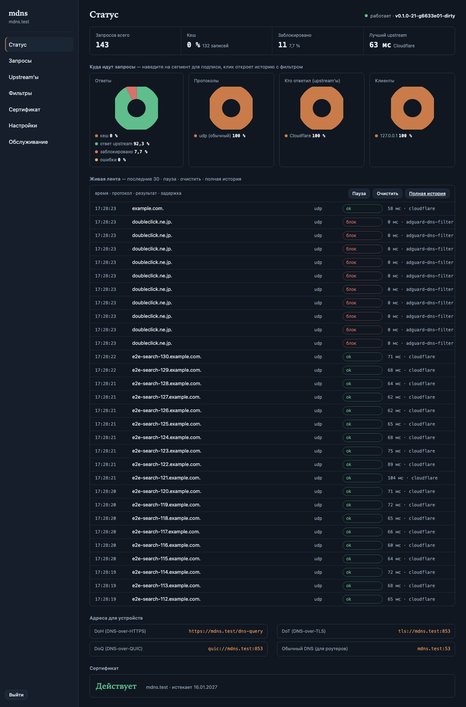
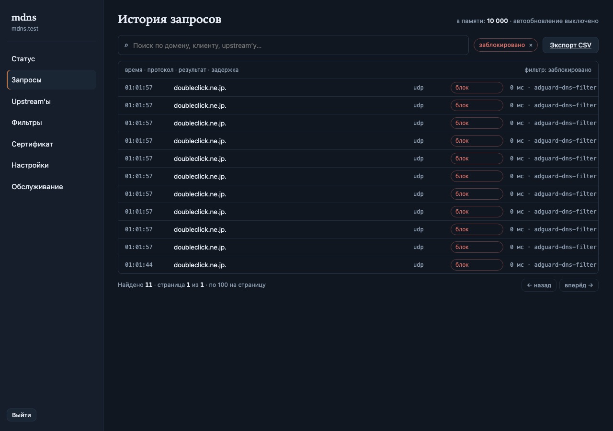
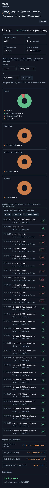

# mdns

[](https://github.com/grendervill/mdns/actions/workflows/ci.yml)

A self-hosted DNS service for personal VPS: it answers DNS-over-HTTPS,
DNS-over-TLS, DNS-over-QUIC and plain DNS queries for your devices and
forwards them to a pool of public upstream resolvers, picking the
fastest healthy one, caching answers and keeping a query log.

All five plans of the project are implemented (plans 1–5 of 5): the core
engine (config, upstream transports plain/DoT/DoH/DoQ, answer cache,
health monitor, routing strategies, query log, rate limiting, the
listeners for all four protocols), the own block-list engine, the
management layer (a control API on a unix socket, a terminal UI
(`mdns`) and the first-run wizard (`mdns setup`)), automatic ACME
certificates with renewal and the one-command installer with the
`status` / `diag` / `logs` / `install` / `uninstall` CLI, and — in the
last plan — the admin web panel together with the local performance
stand and the browser end-to-end test. The only remaining item is
deployment on your own VPS.

Design and plans live in `docs/superpowers/`:

- `docs/superpowers/specs/2026-10-17-mdns-design.md` — the design.
- `docs/superpowers/plans/2026-10-17-mdns-core.md` — the core plan.
- `docs/superpowers/plans/2026-10-17-mdns-filters.md` — filtering.
- `docs/superpowers/plans/2026-10-17-mdns-control.md` — the control layer.
- `docs/superpowers/plans/2026-10-17-mdns-tls-install.md` —
  certificates and the installer.
- `docs/superpowers/plans/2026-10-18-mdns-panel.md` — the web panel and
  the polish around it.

## Requirements

- Go 1.26 or newer (quic-go v0.64 needs it) to build from source.
- Linux (Ubuntu 24.04 / Debian 13) with systemd for deployment; macOS
  works for local development.
- The installer runs as root (it writes `/usr/local/bin`,
  `/etc/systemd/system` and `/etc/mdns`). `iproute2` is recommended:
  the port preflight uses `ss` from it to tell the running `mdns`
  holding its own ports from a foreign listener; without `ss` a busy
  port is reported as taken and the install stops.

## Install (one command)

On a fresh Ubuntu 24.04 or Debian 13 VPS, as root:

```sh
curl -fsSL https://raw.githubusercontent.com/grendervill/mdns/main/install.sh | sudo bash
```

The wizard asks for the domain, the certificate, the ports, the DNS
providers and the filter preset, and whether to enable the web panel
(with its password). The same install without any question:

```sh
curl -fsSL https://raw.githubusercontent.com/grendervill/mdns/main/install.sh | sudo bash -s -- \
  --non-interactive --domain dns.example.com --tls acme --acme-email me@example.com
```

`install.sh` is served from the repository's `main` branch, but the
binary it installs comes from a GitHub release — the latest one, or the
one `--version` pins. To install a binary built from the working tree
instead, run `make build` and pass it with `--local`:

```sh
sudo bash install.sh --local ./bin/mdns --non-interactive --domain dns.example.com
```

Flags of `install.sh` (`bash install.sh --help`):

| Flag | Effect |
| --- | --- |
| `--local <file>` | install the given binary instead of downloading a release |
| `--version vX.Y.Z` | download that release instead of the latest one |
| `-h`, `--help` | print the help |

Every other argument is passed to `mdns install` unchanged.

The script picks the release for this machine (`mdns-linux-amd64` or
`mdns-linux-arm64`), verifies it against the release `SHA256SUMS` and
aborts if the checksum does not match, installs it as
`/usr/local/bin/mdns`, and hands over to `mdns install`.

### What `mdns install` does

1. **Preflight** (a failure aborts before anything is written, a
   warning is printed and does not stop the install):
   root rights; a supported distribution (Ubuntu 24.04 / Debian 13);
   architecture amd64 or arm64; systemd present; the ports the selected
   protocols need are bindable — a port held by the running `mdns`
   itself is fine, the re-run restarts it; a running `systemd-resolved`
   stub listener on `:53` is a warning with the fix to apply
   (`DNSStubListener=no`); the public A/AAAA record of the domain
   should point at this server, otherwise ACME cannot issue a
   certificate; at least 500 MB free on the install filesystem.
2. **Directories** — `/etc/mdns` (0755) and the data directory
   `/var/lib/mdns` (0700).
3. **Binary** — installed as `/usr/local/bin/mdns`.
4. **Config** — the wizard writes `/etc/mdns/config.json`, or the
   non-interactive spec builds it from the flags.
5. **systemd unit** — `/etc/systemd/system/mdns.service`
   (`ExecStart=/usr/local/bin/mdns serve --config /etc/mdns/config.json`,
   `Restart=always`, `LimitNOFILE=65536`), then `daemon-reload`,
   `enable` and `restart`.
6. **Firewall** — when ufw is active its rules are added (plain DNS,
   DoH, DoT, DoQ, plus `80/tcp` when ACME falls back to HTTP-01);
   otherwise the exact `ufw allow` lines to run by hand are printed.
7. **Summary** — the domain, the enabled protocols with ready-to-use
   device links, the upstreams, the strategy, the web panel state (its
   URL and login when it is on) and the installed paths.

The non-interactive flags (`mdns install --help`): `--non-interactive`,
`--dry-run`, `--reconfigure`, `--config`, `--data-dir`, `--domain`,
`--tls` (`acme`, `self-signed`, `files`), `--acme-provider`,
`--acme-email`, `--acme-directory`, `--acme-insecure`, `--eab-kid`,
`--eab-hmac`, `--cert-file`, `--key-file`, `--provider` (repeatable,
resolver catalog id), `--strategy`, `--plain-port`, `--doh-port`,
`--dot-port`, `--doq-port`, `--filter` (`off`, `basic`, `strict`),
`--panel`, `--no-panel`, `--password` (the web panel admin password; see
[Web panel](#web-panel)).
Only `--domain` is required with `--non-interactive`. `--dry-run`
prints the plan and changes nothing (it still runs the full preflight,
so it needs root).

### Re-running, updating, removing

Re-running the one-liner is the upgrade path: the binary and the unit
are replaced and the service restarts. In the non-interactive form an
existing `/etc/mdns/config.json` is kept (the run says so);
`--reconfigure` rewrites it — the running daemon picks the new
configuration up without a manual restart. Without `--non-interactive`
the wizard opens again.

```sh
sudo mdns uninstall                 # asks for confirmation on a terminal
sudo mdns uninstall --yes           # no question
sudo mdns uninstall --purge         # also remove the config, the data and the certificates
sudo mdns uninstall --keep-binary   # leave /usr/local/bin/mdns in place
```

`mdns uninstall` stops and disables the service, removes the unit and
the binary, and keeps `/etc/mdns/config.json`, `/var/lib/mdns` and the
certificates by default, so a reinstall finds them again; `--purge`
removes them too. A second uninstall does not fail: missing paths are
reported, not treated as errors. The ufw rules `mdns install` added are
not removed by `mdns uninstall`; close the ports by hand (`sudo ufw
delete allow …`) if you no longer need them.

## Build

```sh
make build          # produces bin/mdns
./bin/mdns version
```

## Run locally

```sh
./bin/mdns serve --config examples/config.json
```

The example config answers on high ports (plain 5533, DoH 8443, DoT
8853, DoQ 8853) with a self-signed certificate for `mdns.test`, so
nothing needs root and the real ports stay free. (Port 5533 rather
than the common 5353: on macOS that port belongs to the system's own
mDNS responder.)

Query it (in another terminal):

```sh
# plain DNS
dig @127.0.0.1 -p 5533 example.com

# DNS-over-HTTPS (self-signed certificate: -k)
Q=$(printf '\x12\x34\x01\x00\x00\x01\x00\x00\x00\x00\x00\x00\x07example\x03com\x00\x00\x01\x00\x01' | base64 | tr '+/' '-_' | tr -d '=')
curl -k -H 'Accept: application/dns-message' "https://127.0.0.1:8443/dns-query?dns=$Q" | xxd | head
```

Validate a config without starting anything:

```sh
./bin/mdns check --config examples/config.json   # prints "ok"
```

## Configuration

`/etc/mdns/config.json` in production (the path is a flag). The full
schema is in `internal/config/config.go`; the example shows every
section:

- `protocols` — which listeners are on and on which ports.
- `tls` — `self-signed`, `files` (paths to a certificate pair) or
  `acme` (automatic issuance and renewal; see below).
- `upstreams` — public resolvers: `transport` is one of `plain`, `dot`,
  `doh` (a full URL) or `doq`; `server_name` sets the TLS SNI when the
  address is an IP; `insecure_skip_verify` allows self-signed upstreams.
- `strategy` — `fastest` (default), `failover`, `round_robin` or
  `random`.
- `cache` — entry count (at least 1) and TTL clamp.
- `limits` — plain-DNS per-IP rate limit and trusted CIDRs
  (exempt from it).
- `log` — in-memory entry count and an optional JSONL file.
- `panel` — the web panel: `enabled` and the argon2id `password_hash`
  (see [Web panel](#web-panel)).
- `data_dir` — where persistent data lives (filter list caches and the
  ACME certificates); defaults to `/var/lib/mdns`.

### Certificates (ACME)

`tls.mode` selects where the server certificate comes from:

- `self-signed` — an ECDSA P-256 certificate for the domain, generated
  in memory at every startup and never written to disk, so each restart
  regenerates it. It is valid for 90 days — that is only its lifetime,
  not something a restart extends. Good for a first try; every client
  needs `-k` / an explicit trust.
- `files` — the PEM pair given by `tls.cert_file` and `tls.key_file`.
  It is loaded at startup, so a missing or broken pair fails the start
  instead of the first handshake.
- `acme` — the certificate is issued and renewed automatically:

```json
"tls": {
  "mode": "acme",
  "acme": {
    "provider": "letsencrypt",
    "email": "me@example.com"
  }
}
```

| Provider | Directory | Required |
| --- | --- | --- |
| `letsencrypt` (default) | `https://acme-v02.api.letsencrypt.org/directory` | `email` |
| `zerossl` | `https://acme.zerossl.com/v2/DV90` | `email`, the EAB pair `eab_kid` + `eab_hmac` issued by ZeroSSL |
| `custom` | your own `directory_url` (must be https) | `directory_url` |

`acme.insecure_skip_verify` (CLI `--acme-insecure`) skips the TLS
verification of the ACME directory; it exists for a test CA on the
local network and is not meant for production.

The non-interactive install takes the same values as flags:
`--tls acme --acme-provider zerossl --acme-email … --eab-kid … --eab-hmac …`
(or `--acme-directory` for a custom CA); the wizard asks for them in
the certificate step.

**How the domain is validated.** With DoH enabled on port 443 the
daemon uses TLS-ALPN-01 (RFC 8737): that DoH listener starts before any
certificate exists and advertises the `acme-tls/1` protocol, so the CA
can validate the name on the DoH port itself. In every other
configuration it falls back to HTTP-01: a responder binds `:80` and
answers `/.well-known/acme-challenge/…`, returning 404 to anything
else, while the DoH listener waits for the certificate like DoT and
DoQ.

**While there is no certificate yet, or when issuance fails.** The
daemon is up and useful: plain DNS and the local management (control
API, TUI, `mdns status`) work, while the TLS listeners stay closed —
apart from the DoH listener on 443, which is up for the challenge only
(a normal handshake there fails). The certificate state is visible as
`waiting` or `error` with the CA's message in `mdns status`, TUI and
the API (`/api/v1/status`), and the event stream publishes every
change. Failed attempts are retried with a backoff from 5 minutes,
doubling up to 6 hours, spread by ±20% jitter, until the first
success; once the certificate arrives the TLS listeners start without
a restart of the daemon.

**Switching a running daemon to ACME.** Changing `tls.mode` to `acme`
on a daemon that is already serving (a config update or
`mdns install --reconfigure`) takes DoT and DoQ offline until the
certificate is issued, and the status shows the `waiting` state
meanwhile. The switch is a structural config change, so the daemon
rebinds its listeners: plain DNS can see a refused window of up to a
few seconds while the old runtime stops and the new one starts. If the
new runtime fails to come up, the old one is restored and keeps
serving (rollback). A fresh install configured with ACME from the
start has no such window — nothing was serving TLS before.

**Renewal.** autocert renews over the handshake path before the leaf
expires — at the lesser of 30 days or a third of the certificate
lifetime (30 days for a 90-day certificate) — and the daemon rechecks
the certificate once a day. There is no restart and no gap.

**Where the certificate lives.** The ACME account key and the issued
certificates are kept under `<data_dir>/certs/acme`
(`/var/lib/mdns/certs/acme` with the default data directory), written
0600 into the 0700 data directory. They survive a reinstall — `mdns
install` never touches them — and `mdns uninstall` keeps them unless
`--purge` is given, so a reinstall (or a restart while the CA is
unreachable) keeps serving the stored certificate.

### Filtering (block lists)

The own block-list engine is off by default; turn it on in the config:

```json
"filter": {
  "enabled": true,
  "mode": "zero",
  "update_interval_hours": 24,
  "lists": [
    { "id": "oisd-small" },
    { "id": "custom", "url": "https://example.com/my-list.txt" }
  ],
  "user_allow": ["allowed.example.com"],
  "user_block": ["manual.example.com"]
}
```

- `mode` — how blocked names are answered: `zero` (A → `0.0.0.0`,
  AAAA → `::`, other types NODATA), `nxdomain` or `refused`.
- `lists` — catalog IDs or your own HTTPS URLs. Each list refreshes
  every `update_interval_hours` (0 = fetch once at startup) with
  conditional requests; cached copies live in `<data_dir>/filters` and
  keep working when a list server is down.
- Catalog: `adguard-dns-filter`, `adguard-base`, `ublock-filters`,
  `easylist`, `peter-lowe`, `oisd-small`, `oisd-full`, `hagezi-pro`,
  `hagezi-proplus`, `stevenblack-unified`, `1hosts-lite`. The wizard's
  `basic` (adguard-dns-filter + oisd-small) and `strict` presets are
  shortcuts over this catalog.
- `user_allow` / `user_block` — your own rules; each covers the domain
  and its subdomains. A user allow beats everything, then user blocks,
  then list exceptions (`@@`), then list rules.
- Lists may be adblock-style (`||domain^`, `@@||domain^`), hosts files
  (`0.0.0.0 domain`) or plain domain lists; cosmetic rules, modifiers
  and junk lines are skipped and counted.
- Filtering happens in the core before cache and upstream, so blocked
  names are answered the same way over plain DNS, DoT, DoH and DoQ.

## CLI

One binary, `mdns`; every command has a `--help`.

| Command | What it does |
| --- | --- |
| `mdns` | open the TUI (prints a hint when the daemon is not running) |
| `mdns setup [--config <path>]` | first-run wizard: writes the config, prints the device links |
| `mdns serve [--config <path>] [--socket <path>]` | run the DNS server in the foreground (this is what the unit runs) |
| `mdns check [--config <path>]` | validate the configuration file, print `ok` |
| `mdns status [--json] [--socket <path>]` | daemon state from the control API: listeners, certificate, upstream health, cache, filters |
| `mdns diag [--config <path>] [--socket <path>] [--data-dir <path>]` | installation self-check: config, ports, certificate, upstream reachability, data dir, unit |
| `mdns logs [-n <N>] [-f] [--config <path>]` | tail the daemon log: the configured log file, the systemd journal otherwise |
| `mdns install [flags]` | install or update the service: binary, config, systemd unit, firewall; the web panel is turned on with `--panel --password` (see above) |
| `mdns uninstall [--purge] [--keep-binary] [--config <path>] [--data-dir <path>] [--yes]` | remove the service; config, data and certificates survive unless `--purge` (`--non-interactive` is the same as `--yes`) |
| `mdns tui [--socket <path>]` | open the terminal interface |
| `mdns version` | print the version |

`mdns status` needs the running daemon (it reads the control API over
the unix socket). `mdns diag` works either way: it reads the config,
the ports, the data directory and the unit from the filesystem and
reports the certificate and the upstream health from the daemon when
it answers.

## Control: TUI, wizard and the daemon API

The daemon exposes a control API on a unix socket (`/run/mdns/mdns.sock`
by default; `serve --socket <path>` overrides it). The TUI and the
wizard are thin clients of that API; the web panel runs inside the
daemon and shares the same controller. All three therefore read and
write through one core, so the terminal interface, the web panel and the
daemon always agree — the daemon is the single source of truth.

### TUI

Run `mdns` with no arguments (opens the TUI when the daemon socket
answers, prints a hint otherwise) or `mdns tui --socket <path>`:

- **1 Статус** — domain, listeners, ready-to-use links, upstream health,
  cache counters and the certificate state.
- **2 Визард** — the setup wizard running against the live daemon
  (same steps as `mdns setup`, the web panel step included; `ctrl+c`
  closes it without saving).
- **3 Запросы** — the live query journal: time, protocol, client,
  domain, type, result, source (cache, upstream or block list) and
  latency. `f` opens the filter line, a case-insensitive substring over
  domain, client, upstream or protocol; `enter` applies it, `esc` while
  typing keeps the previous filter, and `esc` on the feed clears it.
  `space` pauses the feed, `x` clears it, `↑↓` (or `j`/`k`) scrolls, and
  while a filter is set the line above the table shows how many of how
  many entries match.
- **4 Upstream'ы** — per-upstream state, EWMA latency, sent/failed.
- **5 Фильтры** — per-list state; `enter` refreshes the list under the
  cursor, `u` — all lists, `m` cycles the block mode, `a` adds a user
  rule (`block domain` / `allow domain`).
- **6 Настройки** — the key config fields in place; `enter` edits or
  toggles, `ctrl+s` applies (`w` opens the wizard).
- **7 Диагностика** — the self-check over the daemon API, without
  leaving the terminal: config round-trip, listeners against the config,
  certificate, upstream probes, block lists and version, each marked ✓
  (passing), ! (warning) or ✗ (failure). This is the daemon-side part of
  `mdns diag`; the filesystem checks (data directory, systemd unit) stay
  with the CLI.

`?` opens the key reference as an overlay (`esc` returns), `q` quits,
`r` reloads the active screen's data, digits switch screens.

### First-run wizard

```sh
mdns setup --config /etc/mdns/config.json
```

The steps: domain, certificate (Let's Encrypt, ZeroSSL with its EAB
credentials, a custom ACME CA, self-signed or your own PEM files),
protocols and ports, DNS providers with live latency probes (pick
several, choose the per-provider transport with `t`), routing
strategy, filter preset, and the web panel (on/off; when on, the admin
password typed twice, of which only an argon2id hash is saved). On save
it writes the config and prints the ready-to-use device links, and the
panel URL when the panel is on.

### Control API

```sh
curl -s --unix-socket /run/mdns/mdns.sock http://localhost/api/v1/status
```

| Endpoint | Method | Purpose |
| --- | --- | --- |
| `/api/v1/status` | GET | listeners, upstream health, cache, filter counters |
| `/api/v1/config` | GET | the full current configuration |
| `/api/v1/config` | PUT | validate, apply and persist a full configuration |
| `/api/v1/providers` | GET | the resolver catalog (with all endpoints) |
| `/api/v1/probe` | POST | measure endpoints: `{"endpoints": [...]}` |
| `/api/v1/stats` | GET | cumulative counters by outcome, protocol, upstream and client |
| `/api/v1/requests` | GET | the query journal: `?n=100` (newest first) |
| `/api/v1/requests` | GET | paged and filtered: `?page=&per=&q=&outcome=&proto=&client=&upstream=` |
| `/api/v1/filter/status` | GET | per-list state (rules, errors, timestamps) |
| `/api/v1/filter/update` | POST | refresh one list (`{"id": "oisd-small"}`) or all (`{"id": ""}`) |
| `/api/v1/events` | GET | SSE stream: `requests`, `upstreams`, `filter`, `ping` |

Updating the configuration from a script:

```sh
curl -s --unix-socket /run/mdns/mdns.sock http://localhost/api/v1/config > cfg.json
# edit cfg.json ...
curl -s -X PUT -H 'Content-Type: application/json' --data @cfg.json \
  http://localhost/api/v1/config     # -> {"status":"applied"}
```

`PUT /config` applies what it can without a restart (routing strategy,
cache sizes, rate limits, filter mode and user rules, update interval)
and restarts listeners only for structural changes (domain, TLS,
protocols, upstreams, log, data dir, filter lists). If the new runtime
fails to come up, the previous one keeps serving and the API returns
the error.

## Web panel

The web panel is the browser face of the daemon: status, query history,
upstreams, filters, certificate state, settings and maintenance. It
opens no port of its own — the daemon mounts it on the DoH listener next
to `/dns-query`, on the same TLS endpoint:

```text
https://dns.example.com/
```

The port is the DoH port (443 by default): with a non-443 DoH port the
panel lives at `https://<domain>:<port>/`. The login is `admin` and the
password chosen at setup; change it later on the **Настройки** page. The
panel is therefore reachable only while DoH is enabled, and it presents
the DoH certificate.

### Enabling the panel

In the wizard (the «Веб-панель» step, the same one embedded in `mdns`)
answer «д» and type the password twice. In the non-interactive installer:

```sh
sudo mdns install --non-interactive --domain dns.example.com --tls acme \
  --acme-email me@example.com --panel --password 'a long admin password'
```

`--password` alone also turns the panel on; `--panel` without a password
is rejected; `--no-panel` keeps it off even when a password is passed.
The password needs at least 8 characters and no leading or trailing
space. Only an argon2id hash is written to the config
(`panel.password_hash`) — never the password itself. When the panel is
off, every panel route answers `404`, `/`, `/login` and `/panel/…`
included, so a scan cannot tell that a panel exists.

### Pages

All pages are server-rendered; there is no framework — one small script
drives the chart tooltip and the live feed.

- **Статус** (`/panel/`) — four all-time gauges (queries total, cache
  hit rate and entries, blocked share, fastest healthy upstream), a
  period form, four donut charts (outcomes, protocols, upstreams,
  clients), the device links and the certificate state. The period form
  switches the charts and the «За период» totals to Месяц, 3 месяца,
  6 месяцев, 12 месяцев or a custom date range (whole UTC days); the
  gauges above stay all-time. Hovering a segment shows its label and
  share; clicking it opens the history filtered by that segment. Folded
  slices — «прочие» when a chart has more than six segments, and the
  clients' «остальные» row — have no single value to filter on and are
  drawn without a link. Below is the live feed of the last 30 queries,
  with pause and clear buttons and a link to the full history; the feed
  rows, the history table and the CSV export all use the timezone set
  in Настройки.
- **Запросы** (`/panel/history`) — «История запросов», deliberately not
  live (no auto-refresh): 100 rows per page, newest first, with a search
  box (case-insensitive substring of domain, client IP or upstream ID)
  and removable filter chips for outcome, protocol, client and upstream.
  The chips are exactly what the status donuts link to. «Экспорт CSV»
  downloads every row matching the current filter, not just the visible
  page; a cell that starts with a spreadsheet formula character (`=`,
  `+`, `-`, `@`, tab or carriage return) is prefixed with `'`, so a
  hostile query name cannot execute in Excel or LibreOffice. The file is
  UTF-8 with a byte-order mark and `;`-separated for the Russian Excel
  locale.
- **Upstream'ы** — each upstream's state, latency and answered/error
  share; add a provider endpoint from the built-in catalog (Cloudflare,
  Google, Quad9, Яндекс DNS, AdGuard DNS, DNS.SB, Mullvad, Control D,
  OpenDNS and the family variants), add a custom upstream (ID, transport
  `plain`/`dot`/`doh`/`doq`, address, SNI for DoT/DoQ by IP, priority),
  remove one, enable or disable one, and edit the priority column (the
  order `failover` walks). The routing strategy (`fastest`, `failover`,
  `round_robin`, `random`) is selectable on this page too. Upstream
  hostnames are resolved through a bootstrap DNS list
  (`1.1.1.1`/`8.8.8.8`/`9.9.9.9`), so the daemon keeps resolving when
  the machine's own resolver points at mdns.
- **Фильтры** — a catalog of ready public block lists (AdGuard DNS/Base,
  uBlock Origin, EasyList, Peter Lowe, OISD Small/Full, HaGeZi Pro/Pro++,
  Steven Black, 1Hosts Lite) with one-click add/remove, plus a custom
  `https` list by ID and URL; per-list applied/skipped rules, update time
  and state; refresh one list or every list; pick the block mode
  (`zero`, `nxdomain`, `refused`); add and remove user allow/block rules
  (each covers the domain and its subdomains).
- **Сертификат** — read-only: state, issuer, expiry, last check and the
  TLS mode/ACME fields from the config. Issuance and renewal stay with
  the daemon; the ACME wizard (provider, EAB keys, custom directory)
  lives in the TUI and `mdns setup`, not in the panel.
- **Настройки** — the key fields: domain, strategy, protocols and ports,
  cache size and TTL clamp, the plain-DNS rate limit, the filter on/off
  and update interval, and the display timezone (an IANA name such as
  `Europe/Moscow`; empty keeps the server's local zone). Applying
  revalidates the whole config; soft changes land in place and
  structural ones rebuild the listeners. The panel password («Пароль
  веб-панели», 8+ characters, typed twice) is changed on this page, and
  open sessions stay valid after it.
- **Обслуживание** — version, uptime and start time; download the live
  config as JSON (it contains the panel password hash and the ACME EAB
  HMAC, and the page warns to treat it as a secret); apply the current
  config again through validation, the web twin of the TUI's apply.

### How much history is kept

The query journal is an in-memory ring sized by `log.memory_entries`
(default 10 000; the history page shows the capacity as «в памяти:
10 000»). “Full history” therefore means every entry still in the ring:
the oldest entries are overwritten as new queries arrive, and a restart
starts the ring empty. Set `log.file` if you need an on-disk JSONL
archive beyond the ring.

### Security

- The password is stored only as an argon2id PHC hash (64 MiB, 3
  iterations, 2 parallel lanes at the current cost) and verified in
  constant time.
- The session cookie is `HttpOnly`, `Secure` and `SameSite=Lax`, lives
  30 days and is kept in memory, so a daemon restart logs everybody out.
  After five failed logins from one address, further attempts answer
  `429` until 15 minutes after the last failure.
- Every mutation needs a CSRF token bound to the session; the login form
  has its own, bound to a pre-session cookie. A bad token is a `403` and
  leaves the session alive.
- Pages go through `html/template`'s contextual escaping. Every HTML
  page response carries `Content-Security-Policy: frame-ancestors 'none';
  default-src 'self'`, `X-Frame-Options: DENY`,
  `X-Content-Type-Options: nosniff` and `Cache-Control: no-store`; the
  embedded static assets under `/panel/static/` are sent with
  `Cache-Control: max-age=3600` instead.
- CSS and JS are embedded in the binary: no framework, no CDN and no
  external font or asset request, so the panel works on an isolated
  network.

### Layout and screenshots

The layout collapses the rail into a top bar and stacks the gauges,
charts and feed; the browser test renders the status page at 390×844
and checks there is no horizontal overflow and that blocked names stay
readable.







## Performance

[`docs/perf-results.md`](docs/perf-results.md) records a repeatable local
run of `scripts/perf-local.sh` — an Apple M4 macOS machine, no Docker, all
four protocols, cache 50 000, journal ring 20 000, the filter engine on
and the panel on:

- plain DNS, 20 000 000 UDP queries: **~58.8k qps** (p50 < 1 ms,
  p95 2–5 ms, no errors);
- 60-second burst with 128 workers: **~57.1k qps** (3.43M queries, no
  errors);
- DoH, 100 000 GETs: **~70.4k qps**;
- `mdns status` under load: **14 ms**; an authenticated panel page:
  **14.7 ms**; TUI screen changes: **≤ 77 ms**;
- daemon memory after the full run: **~131 MB** physical footprint
  (`vmmap`; `ps` RSS reads higher because it counts shared pages).

The VPS numbers are not measured yet — they will be added to the same
document once the deployment run exists. The document has the
methodology, thresholds and the counter-convergence checks.

## Tests

```sh
make test           # go test ./...
make race           # go test -race ./...
make vet
```

The end-to-end test (`internal/app/e2e_test.go`) brings up the whole
server in-process on high ports with fake upstreams and exercises all
four protocols, the cache and failover.

A Docker smoke test runs the built linux binary in real target images
(`ubuntu:24.04` and `debian:trixie`), starts every protocol with the
filter engine on a real block list, and checks plain DNS, DoT, DoQ,
DoH and the persisted rules:

```sh
scripts/docker-smoke.sh            # both images
scripts/docker-smoke.sh ubuntu:24.04
```

Three more end-to-end scripts need Docker; they exercise the parts the
in-process test cannot:

```sh
scripts/e2e-pebble.sh    # ACME against a local pebble CA: issuance over
                         # tls-alpn-01, failure and self-heal, certificate
                         # cache reuse, live switch to ACME on a running daemon
scripts/e2e-install.sh   # the installer in a systemd container: download
                         # mode, idempotent re-run, --reconfigure, uninstall,
                         # and that a failed install leaves no half-state
scripts/e2e-panel.sh     # the web panel in a real Chromium: login and CSRF,
                         # donut hover/click, filtered history and paging,
                         # the SSE feed, a 390 px viewport, and a disabled
                         # panel answering 404 on every route
```

`scripts/e2e-panel.sh` installs mdns in a systemd container twice — phase A
with `--panel --password`, phase B without it — and drives Playwright from
the host. Playwright is not a repository dependency: the script creates a
local `.venv-pw` (gitignored) and downloads Chromium on first use, saying
so first.

The performance stand needs no Docker and runs on macOS or Linux:

```sh
scripts/perf-local.sh    # full run, about 7 minutes; the numbers in
                         # docs/perf-results.md come from it
PERF_TOTAL=200000 PERF_BURST=5s PERF_DOH_TOTAL=5000 PERF_PROBE_DELAY=0 \
  scripts/perf-local.sh  # quick repeatability run
```
