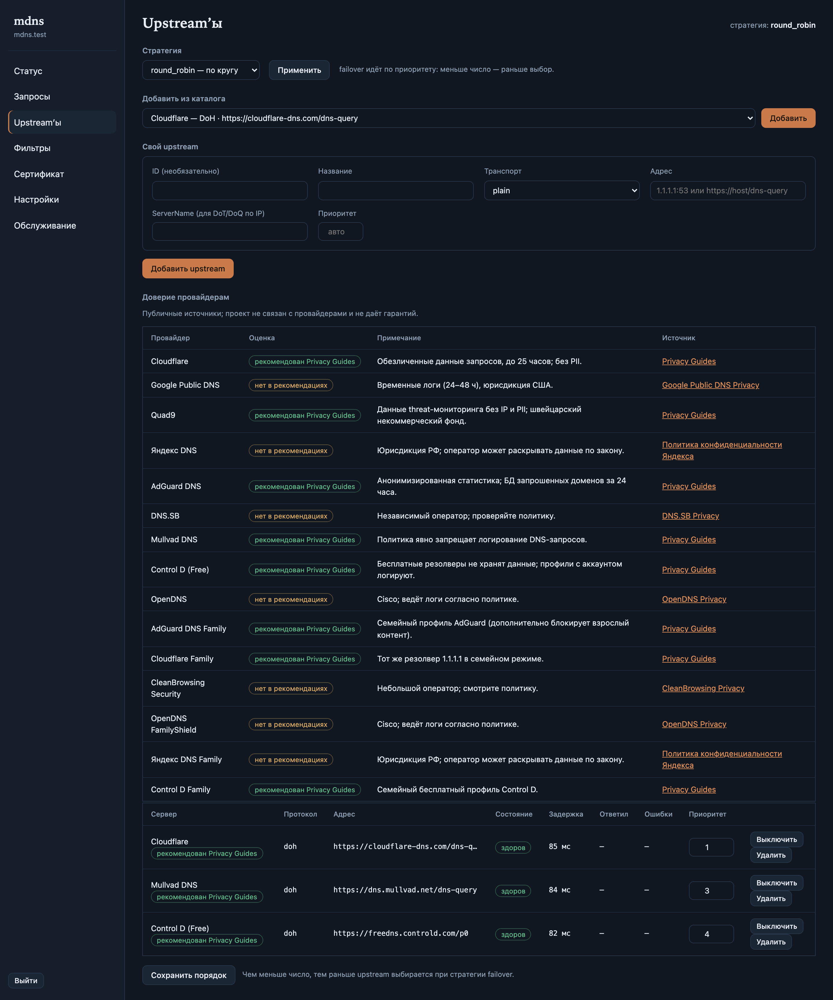
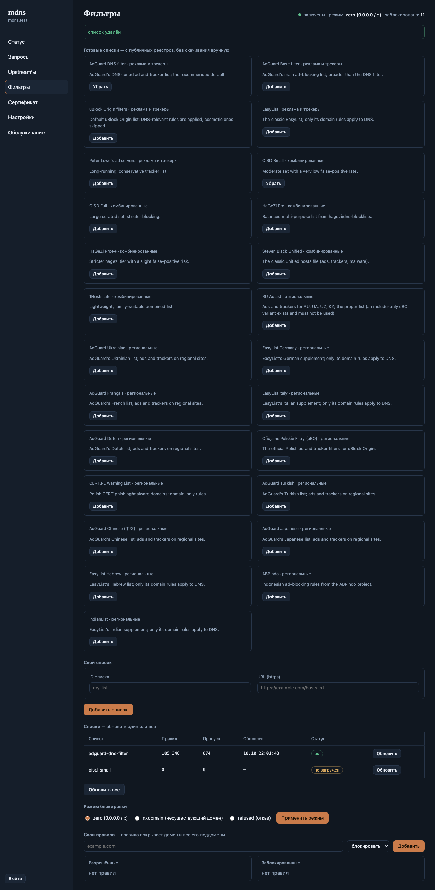
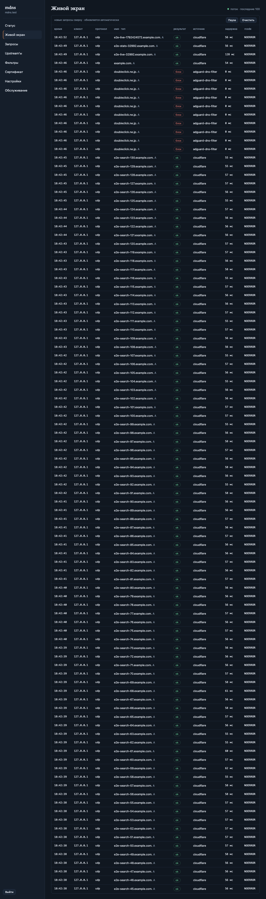

[English](README.md) · **Русский**

# mdns

[](https://github.com/grendervill/mdns/actions/workflows/ci.yml)

Самостоятельно размещаемый DNS-сервис для личного VPS: отвечает на
запросы по DNS-over-HTTPS, DNS-over-TLS, DNS-over-QUIC и обычному DNS
для ваших устройств и пересылает их пулу публичных upstream-резолверов,
выбирая самый быстрый из здоровых, кешируя ответы и ведя журнал
запросов.

Все пять планов проекта реализованы (планы 1–5 из 5): ядро (конфиг,
транспорты upstream plain/DoT/DoH/DoQ, кеш ответов, монитор здоровья,
стратегии маршрутизации, журнал запросов, ограничение частоты,
слушатели для всех четырёх протоколов), собственный движок блок-листов,
слой управления (control API на unix-сокете, терминальный интерфейс
(`mdns`) и мастер первого запуска (`mdns setup`)), автоматические
ACME-сертификаты с продлением и установщик одной командой с CLI
`status` / `diag` / `logs` / `install` / `uninstall`, а в последнем
плане — админская веб-панель вместе с локальным стендом
производительности и браузерным end-to-end тестом. Остался только
один пункт — развёртывание на собственном VPS.

Проектирование и планы лежат в `docs/superpowers/`:

- `docs/superpowers/specs/2026-10-17-mdns-design.md` — дизайн.
- `docs/superpowers/plans/2026-10-17-mdns-core.md` — план ядра.
- `docs/superpowers/plans/2026-10-17-mdns-filters.md` — фильтрация.
- `docs/superpowers/plans/2026-10-17-mdns-control.md` — слой управления.
- `docs/superpowers/plans/2026-10-17-mdns-tls-install.md` —
  сертификаты и установщик.
- `docs/superpowers/plans/2026-10-18-mdns-panel.md` — веб-панель и
  всё, что вокруг неё.

## Требования

- Go 1.26 или новее (это нужно quic-go v0.64), чтобы собрать из
  исходников.
- Linux (Ubuntu 24.04 / Debian 13) с systemd для развёртывания; macOS
  подходит для локальной разработки.
- Установщик работает от root (он пишет в `/usr/local/bin`,
  `/etc/systemd/system` и `/etc/mdns`). Рекомендуется `iproute2`:
  предполётная проверка портов использует `ss` из него, чтобы отличить
  запущенный `mdns`, держащий свои порты, от чужого слушателя; без `ss`
  занятый порт считается чужим, и установка останавливается.

## Установка (одна команда)

На свежем VPS с Ubuntu 24.04 или Debian 13, от root:

```sh
curl -fsSL https://raw.githubusercontent.com/grendervill/mdns/main/install.sh | sudo bash
```

Мастер спросит домен, сертификат, порты, DNS-провайдеров и пресет
фильтрации, а также нужно ли включить веб-панель (и её пароль). Та же
установка без единого вопроса:

```sh
curl -fsSL https://raw.githubusercontent.com/grendervill/mdns/main/install.sh | sudo bash -s -- \
  --non-interactive --domain dns.example.com --tls acme --acme-email me@example.com
```

`install.sh` отдаётся из ветки `main` репозитория, но бинарник, который
он ставит, берётся из GitHub-релиза — последнего либо того, который
задан в `--version`. Чтобы поставить бинарник, собранный из рабочего
дерева, запустите `make build` и передайте его через `--local`:

```sh
sudo bash install.sh --local ./bin/mdns --non-interactive --domain dns.example.com
```

Флаги `install.sh` (`bash install.sh --help`):

| Флаг | Действие |
| --- | --- |
| `--local <file>` | поставить указанный бинарник вместо скачивания релиза |
| `--version vX.Y.Z` | скачать этот релиз вместо последнего |
| `-h`, `--help` | напечатать справку |

Все остальные аргументы без изменений передаются в `mdns install`.

Скрипт выбирает релиз для этой машины (`mdns-linux-amd64` или
`mdns-linux-arm64`), сверяет его с `SHA256SUMS` из релиза и прерывается,
если контрольная сумма не совпала, ставит бинарник как
`/usr/local/bin/mdns` и передаёт управление `mdns install`.

### Что делает `mdns install`

1. **Предполётная проверка** (ошибка прерывает установку до записи
   чего-либо, предупреждение просто печатается и установку не
   останавливает): права root; поддерживаемый дистрибутив (Ubuntu 24.04
   / Debian 13); архитектура amd64 или arm64; наличие systemd;
   возможность занять порты, нужные выбранным протоколам — порт,
   который держит сам запущенный `mdns`, допустим, повторный запуск его
   перезапустит; работающий stub-слушатель `systemd-resolved` на `:53`
   даёт предупреждение с готовым исправлением (`DNSStubListener=no`);
   публичная A/AAAA-запись домена должна указывать на этот сервер, иначе
   ACME не сможет выпустить сертификат; не менее 500 МБ свободного места
   на файловой системе установки.
2. **Каталоги** — `/etc/mdns` (0755) и каталог данных `/var/lib/mdns`
   (0700).
3. **Бинарник** — устанавливается как `/usr/local/bin/mdns`.
4. **Конфиг** — мастер пишет `/etc/mdns/config.json`, либо
   неинтерактивный режим собирает его из флагов.
5. **Юнит systemd** — `/etc/systemd/system/mdns.service`
   (`ExecStart=/usr/local/bin/mdns serve --config /etc/mdns/config.json`,
   `Restart=always`, `LimitNOFILE=65536`), затем `daemon-reload`,
   `enable` и `restart`.
6. **Файрвол** — если ufw активен, добавляются его правила (обычный DNS,
   DoH, DoT, DoQ, плюс `80/tcp`, когда ACME откатывается к HTTP-01);
   иначе печатаются точные строки `ufw allow`, которые нужно выполнить
   вручную.
7. **Итог** — домен, включённые протоколы с готовыми ссылками для
   устройств, upstream-серверы, стратегия, состояние веб-панели (её URL
   и логин, если она включена) и установленные пути.

Неинтерактивные флаги (`mdns install --help`): `--non-interactive`,
`--dry-run`, `--reconfigure`, `--config`, `--data-dir`, `--domain`,
`--tls` (`acme`, `self-signed`, `files`), `--acme-provider`,
`--acme-email`, `--acme-directory`, `--acme-insecure`, `--eab-kid`,
`--eab-hmac`, `--cert-file`, `--key-file`, `--provider` (можно
повторять, id из каталога резолверов), `--strategy`, `--plain-port`,
`--doh-port`, `--dot-port`, `--doq-port`, `--filter` (`off`, `basic`,
`strict`), `--panel`, `--no-panel`, `--password` (пароль администратора
веб-панели; см. [Веб-панель](#веб-панель)).
С `--non-interactive` обязателен только `--domain`. `--dry-run`
печатает план и ничего не меняет (но всё равно выполняет полную
предполётную проверку, поэтому ему нужен root).

### Повторный запуск, обновление, удаление

Повторный запуск однострочника — это и есть путь обновления: бинарник
и юнит заменяются, сервис перезапускается. В неинтерактивном режиме
существующий `/etc/mdns/config.json` сохраняется (запуск об этом
сообщает); `--reconfigure` перезаписывает его — работающий демон
подхватывает новую конфигурацию без ручного перезапуска. Без
`--non-interactive` снова открывается мастер.

```sh
sudo mdns uninstall                 # спрашивает подтверждение в терминале
sudo mdns uninstall --yes           # без вопроса
sudo mdns uninstall --purge         # также удалить конфиг, данные и сертификаты
sudo mdns uninstall --keep-binary   # оставить /usr/local/bin/mdns на месте
```

`mdns uninstall` останавливает и отключает сервис, удаляет юнит и
бинарник, но по умолчанию сохраняет `/etc/mdns/config.json`,
`/var/lib/mdns` и сертификаты, чтобы повторная установка их нашла;
`--purge` удаляет и их. Повторное удаление не падает: отсутствующие
пути просто отмечаются, а не считаются ошибкой. Правила ufw,
добавленные `mdns install`, не удаляются `mdns uninstall`; закройте
порты вручную (`sudo ufw delete allow …`), если они больше не нужны.

## Сборка

```sh
make build          # создаёт bin/mdns
./bin/mdns version
```

## Локальный запуск

```sh
./bin/mdns serve --config examples/config.json
```

Пример конфигурации отвечает на высоких портах (plain 5533, DoH 8443,
DoT 8853, DoQ 8853) с самоподписанным сертификатом для `mdns.test`,
поэтому root не нужен, а настоящие порты остаются свободными. (Порт
5533, а не привычный 5353: в macOS этот порт занят собственным
mDNS-респондером системы.)

Запросите его (в другом терминале):

```sh
# обычный DNS
dig @127.0.0.1 -p 5533 example.com

# DNS-over-HTTPS (самоподписанный сертификат: -k)
Q=$(printf '\x12\x34\x01\x00\x00\x01\x00\x00\x00\x00\x00\x00\x07example\x03com\x00\x00\x01\x00\x01' | base64 | tr '+/' '-_' | tr -d '=')
curl -k -H 'Accept: application/dns-message' "https://127.0.0.1:8443/dns-query?dns=$Q" | xxd | head
```

Проверьте конфиг, ничего не запуская:

```sh
./bin/mdns check --config examples/config.json   # печатает "ok"
```

## Конфигурация

В продакшене — `/etc/mdns/config.json` (путь задаётся флагом). Полная
схема — в `internal/config/config.go`; пример показывает все разделы:

- `protocols` — какие слушатели включены, на каких портах, а также путь
  DoH (`path`, один сегмент URL, по умолчанию `/dns-query`).
- `tls` — `self-signed`, `files` (пути к паре сертификат/ключ) или
  `acme` (автоматический выпуск и продление; см. ниже).
- `upstreams` — публичные резолверы: `transport` — один из `plain`,
  `dot`, `doh` (полный URL) или `doq`; `server_name` задаёт TLS SNI,
  когда адрес — это IP; `insecure_skip_verify` разрешает
  самоподписанные upstream.
- `strategy` — `fastest` (по умолчанию), `failover`, `round_robin` или
  `random`.
- `cache` — число записей (не меньше 1) и ограничение TTL.
- `limits` — лимит частоты запросов на IP для обычного DNS и доверенные
  CIDR (на них лимит не действует).
- `log` — число записей в памяти и необязательный JSONL-файл.
- `panel` — веб-панель: `enabled` и argon2id-хэш `password_hash`
  (см. [Веб-панель](#веб-панель)).
- `data_dir` — где хранятся постоянные данные (кеши списков фильтрации
  и ACME-сертификаты); по умолчанию `/var/lib/mdns`.

### Сертификаты (ACME)

`tls.mode` выбирает, откуда берётся сертификат сервера:

- `self-signed` — сертификат ECDSA P-256 для домена, генерируемый в
  памяти при каждом запуске и никогда не записываемый на диск, поэтому
  каждый перезапуск создаёт его заново. Он действует 90 дней — это лишь
  его срок жизни, перезапуск его не продлевает. Хорош для первой
  попытки; каждому клиенту нужен `-k` / явное доверие.
- `files` — PEM-пара, заданная в `tls.cert_file` и `tls.key_file`. Она
  загружается при старте, поэтому отсутствующая или битая пара роняет
  запуск, а не первый handshake.
- `acme` — сертификат выпускается и продлевается автоматически:

```json
"tls": {
  "mode": "acme",
  "acme": {
    "provider": "letsencrypt",
    "email": "me@example.com"
  }
}
```

| Провайдер | Каталог ACME | Обязательно |
| --- | --- | --- |
| `letsencrypt` (по умолчанию) | `https://acme-v02.api.letsencrypt.org/directory` | `email` |
| `zerossl` | `https://acme.zerossl.com/v2/DV90` | `email`, пара EAB `eab_kid` + `eab_hmac`, выданная ZeroSSL |
| `custom` | собственный `directory_url` (должен быть https) | `directory_url` |

`acme.insecure_skip_verify` (CLI `--acme-insecure`) пропускает проверку
TLS у ACME directory; он нужен для тестового CA в локальной сети и не
предназначен для продакшена.

Неинтерактивная установка принимает те же значения флагами:
`--tls acme --acme-provider zerossl --acme-email … --eab-kid … --eab-hmac …`
(или `--acme-directory` для собственного CA); мастер спрашивает их на
шаге сертификата.

**Как проверяется домен.** Если DoH включён на порту 443, демон
использует TLS-ALPN-01 (RFC 8737): этот DoH-слушатель стартует раньше,
чем появляется сертификат, и объявляет протокол `acme-tls/1`, поэтому
CA может проверить имя прямо на DoH-порту. Во всех остальных
конфигурациях используется HTTP-01: респондер занимает `:80` и отвечает
на `/.well-known/acme-challenge/…`, возвращая 404 на всё остальное, а
DoH-слушатель ждёт сертификат так же, как DoT и DoQ.

**Пока сертификата ещё нет или когда выпуск не удался.** Демон
работает и приносит пользу: обычный DNS и локальное управление (control
API, TUI, `mdns status`) работают, а TLS-слушатели остаются закрытыми —
кроме DoH-слушателя на 443, который поднят только для challenge
(обычный handshake там не проходит). Состояние сертификата видно как
`waiting` или `error` с сообщением CA в `mdns status`, TUI и API
(`/api/v1/status`), а поток событий публикует каждое изменение.
Неудачные попытки повторяются с backoff от 5 минут, удваиваясь до 6
часов, с разбросом ±20% jitter, до первого успеха; как только
сертификат получен, TLS-слушатели запускаются без перезапуска демона.

**Переключение работающего демона на ACME.** Смена `tls.mode` на `acme`
у демона, который уже обслуживает запросы (обновление конфига или
`mdns install --reconfigure`), отключает DoT и DoQ до выпуска
сертификата, и всё это время статус показывает состояние `waiting`.
Переключение — структурное изменение конфига, поэтому демон
пересоздаёт слушатели: обычный DNS может увидеть окно отказов до
нескольких секунд, пока старый runtime останавливается, а новый
запускается. Если новый runtime не поднялся, восстанавливается старый
и продолжает обслуживать запросы (откат). У свежей установки, сразу
настроенной на ACME, такого окна нет — TLS до этого ничего не
обслуживал.

**Продление.** autocert продлевает сертификат по пути handshake до
истечения листового сертификата — за меньшее из 30 дней или трети срока
жизни сертификата (30 дней для 90-дневного сертификата), — а демон
перепроверяет сертификат раз в сутки. Без перезапуска и без разрыва.

**Где хранится сертификат.** Ключ ACME-аккаунта и выпущенные
сертификаты лежат в `<data_dir>/certs/acme`
(`/var/lib/mdns/certs/acme` при каталоге данных по умолчанию),
записанные с правами 0600 в каталог данных с правами 0700. Они
переживают переустановку — `mdns install` их никогда не трогает, — а
`mdns uninstall` сохраняет их, если не указан `--purge`, поэтому
переустановка (или перезапуск, пока CA недоступен) продолжает отдавать
сохранённый сертификат.

### Фильтрация (блок-листы)

Собственный движок блок-листов по умолчанию выключен; включите его в
конфиге:

```json
"filter": {
  "enabled": true,
  "mode": "zero",
  "update_interval_hours": 24,
  "lists": [
    { "id": "oisd-small" },
    { "id": "custom", "url": "https://example.com/my-list.txt" }
  ],
  "user_allow": ["allowed.example.com"],
  "user_block": ["manual.example.com"]
}
```

- `mode` — как отвечать на заблокированные имена: `zero` (A →
  `0.0.0.0`, AAAA → `::`, остальные типы — NODATA), `nxdomain` или
  `refused`.
- `lists` — id из каталога или ваши собственные HTTPS-URL. Каждый список
  обновляется раз в `update_interval_hours` (0 = загрузить один раз при
  старте) с условными запросами; кешированные копии лежат в
  `<data_dir>/filters` и продолжают работать, когда сервер списка
  недоступен.
- Каталог: `adguard-dns-filter`, `adguard-base`, `ublock-filters`,
  `easylist`, `peter-lowe`, `oisd-small`, `oisd-full`, `hagezi-pro`,
  `hagezi-proplus`, `stevenblack-unified`, `1hosts-lite`. Пресеты
  мастера `basic` (adguard-dns-filter + oisd-small) и `strict` — это
  сокращения над этим каталогом.
- `user_allow` / `user_block` — ваши собственные правила; каждое
  покрывает домен и его поддомены. Пользовательский allow важнее всего,
  затем пользовательские блокировки, затем исключения списков (`@@`),
  затем правила списков.
- Списки могут быть в стиле adblock (`||domain^`, `@@||domain^`),
  hosts-файлами (`0.0.0.0 domain`) или простыми списками доменов;
  косметические правила, модификаторы и мусорные строки пропускаются и
  подсчитываются.
- Фильтрация происходит в ядре до кеша и upstream, поэтому
  заблокированные имена получают одинаковый ответ по обычному DNS, DoT,
  DoH и DoQ.

## CLI

Один бинарник, `mdns`; у каждой команды есть `--help`.

| Команда | Что делает |
| --- | --- |
| `mdns` | открыть TUI (печатает подсказку, если демон не запущен) |
| `mdns setup [--config <path>]` | мастер первого запуска: пишет конфиг, печатает ссылки для устройств |
| `mdns serve [--config <path>] [--socket <path>]` | запустить DNS-сервер на переднем плане (именно это запускает юнит) |
| `mdns check [--config <path>]` | проверить файл конфигурации, напечатать `ok` |
| `mdns status [--json] [--socket <path>]` | состояние демона из control API: слушатели, сертификат, здоровье upstream, кеш, фильтры |
| `mdns diag [--config <path>] [--socket <path>] [--data-dir <path>]` | самопроверка установки: конфиг, порты, сертификат, доступность upstream, каталог данных, юнит |
| `mdns logs [-n <N>] [-f] [--config <path>]` | хвост лога демона: настроенный файл лога, иначе журнал systemd |
| `mdns install [flags]` | установить или обновить сервис: бинарник, конфиг, юнит systemd, файрвол; веб-панель включается через `--panel --password` (см. выше) |
| `mdns uninstall [--purge] [--keep-binary] [--config <path>] [--data-dir <path>] [--yes]` | удалить сервис; конфиг, данные и сертификаты сохраняются, если не указан `--purge` (`--non-interactive` то же, что `--yes`) |
| `mdns tui [--socket <path>]` | открыть терминальный интерфейс |
| `mdns version` | напечатать версию |

`mdns status` требует запущенного демона (он читает control API через
unix-сокет). `mdns diag` работает в обоих случаях: он читает конфиг,
порты, каталог данных и юнит из файловой системы, а сертификат и
здоровье upstream берёт у демона, когда тот отвечает.

## Управление: TUI, мастер и API демона

Демон предоставляет control API на unix-сокете (`/run/mdns/mdns.sock`
по умолчанию; `serve --socket <path>` переопределяет его). TUI и мастер —
тонкие клиенты этого API; веб-панель работает внутри демона и
использует тот же контроллер. Поэтому все три читают и пишут через одно
ядро, и терминальный интерфейс, веб-панель и демон всегда согласованы —
демон является единственным источником истины.

### TUI

Запустите `mdns` без аргументов (открывает TUI, когда сокет демона
отвечает, иначе печатает подсказку) или `mdns tui --socket <path>`:

- **1 Статус** — домен, слушатели, готовые ссылки, здоровье upstream,
  счётчики кеша и состояние сертификата.
- **2 Визард** — мастер настройки, работающий с живым демоном (те же
  шаги, что в `mdns setup`, включая шаг веб-панели; `ctrl+c` закрывает
  его без сохранения).
- **3 Запросы** — живой журнал запросов: время, протокол, клиент, домен,
  тип, результат, источник (кеш, upstream или блок-лист) и задержка.
  `f` открывает строку фильтра — регистронезависимую подстроку по
  домену, клиенту, upstream или протоколу; `enter` применяет её, `esc`
  во время ввода сохраняет прежний фильтр, а `esc` на ленте очищает его.
  `space` ставит ленту на паузу, `x` очищает её, `↑↓` (или `j`/`k`)
  прокручивают, а при заданном фильтре строка над таблицей показывает,
  сколько из скольких записей совпало.
- **4 Upstream'ы** — состояние каждого upstream, EWMA-задержка,
  отправлено/ошибок; `a` добавляет endpoint провайдера из каталога,
  `c` — свой (ID, транспорт, адрес, SNI для DoT/DoQ по IP, приоритет),
  `space` переключает, `d` удаляет, `p` меняет приоритет, `s`
  переключает стратегию, `t` проверяет выбранный upstream.
- **5 Фильтры** — состояние каждого списка; `a` открывает каталог
  готовых списков, `c` добавляет свой https-список, `d` удаляет
  выбранный, `e` включает/выключает фильтрацию, `r` добавляет
  пользовательское правило (`block domain` / `allow domain`), `enter`
  обновляет список под курсором, `u` — все списки, `m` переключает
  режим блокировки.
- **6 Настройки** — ключевые поля конфига на месте (включая часовой
  пояс отображения, путь DoH и интервал обновления списков); `enter`
  редактирует или переключает, `ctrl+s` применяет (`w` открывает
  мастер).
- **7 Диагностика** — самопроверка через API демона, не выходя из
  терминала: round-trip конфига, слушатели против конфига, сертификат,
  пробы upstream, блок-листы и версия, каждая с отметкой ✓ (успех), !
  (предупреждение) или ✗ (ошибка). Это серверная часть `mdns diag`;
  проверки файловой системы (каталог данных, юнит systemd) остаются за
  CLI.

`?` открывает справку по клавишам поверх экрана (`esc` возвращает), `q`
выходит, `r` перезагружает данные активного экрана (на экране 5 вместо
этого добавляет пользовательское правило), цифры переключают экраны.

### Мастер первого запуска

```sh
mdns setup --config /etc/mdns/config.json
```

Шаги: домен, сертификат (Let's Encrypt, ZeroSSL с его EAB-данными,
собственный ACME CA, самоподписанный или ваши PEM-файлы), протоколы и
порты, DNS-провайдеры с живыми пробами задержки (выберите несколько,
транспорт для каждого провайдера задаётся через `t`), стратегия
маршрутизации, пресет фильтрации и веб-панель (вкл/выкл; если включена,
пароль администратора вводится дважды, и сохраняется только его
argon2id-хэш). При сохранении мастер пишет конфиг и печатает готовые
ссылки для устройств, а также URL панели, если она включена.

### Control API

```sh
curl -s --unix-socket /run/mdns/mdns.sock http://localhost/api/v1/status
```

| Эндпоинт | Метод | Назначение |
| --- | --- | --- |
| `/api/v1/status` | GET | слушатели, здоровье upstream, кеш, счётчики фильтра |
| `/api/v1/config` | GET | полная текущая конфигурация |
| `/api/v1/config` | PUT | проверить, применить и сохранить полную конфигурацию |
| `/api/v1/providers` | GET | каталог резолверов (со всеми эндпоинтами) |
| `/api/v1/probe` | POST | измерить эндпоинты: `{"endpoints": [...]}` |
| `/api/v1/stats` | GET | накопительные счётчики по исходу, протоколу, upstream и клиенту |
| `/api/v1/requests` | GET | журнал запросов: `?n=100` (сначала новые) |
| `/api/v1/requests` | GET | постранично и с фильтрами: `?page=&per=&q=&outcome=&proto=&client=&upstream=` |
| `/api/v1/filter/status` | GET | состояние каждого списка (правила, ошибки, время) |
| `/api/v1/filter/update` | POST | обновить один список (`{"id": "oisd-small"}`) или все (`{"id": ""}`) |
| `/api/v1/events` | GET | поток SSE: `requests`, `upstreams`, `filter`, `ping` |

Обновление конфигурации из скрипта:

```sh
curl -s --unix-socket /run/mdns/mdns.sock http://localhost/api/v1/config > cfg.json
# отредактируйте cfg.json ...
curl -s -X PUT -H 'Content-Type: application/json' --data @cfg.json \
  http://localhost/api/v1/config     # -> {"status":"applied"}
```

`PUT /config` применяет без перезапуска всё, что можно (стратегию
маршрутизации, размеры кеша, лимиты частоты, режим фильтра и
пользовательские правила, интервал обновления), и перезапускает
слушатели только при структурных изменениях (домен, TLS, протоколы,
upstream, лог, каталог данных, списки фильтрации). Если новый runtime
не поднялся, продолжает работать прежний, а API возвращает ошибку.

## Веб-панель

Веб-панель — браузерное лицо демона: статус, живой экран запросов,
история запросов, upstream, фильтры, состояние сертификата, настройки
и обслуживание. Она не открывает собственный порт — демон монтирует её
на DoH-слушателе рядом с настроенным путём DoH (`/dns-query` по
умолчанию), на том же TLS-эндпоинте:

```text
https://dns.example.com/
```

Порт — это порт DoH (по умолчанию 443): при DoH на порту, отличном от
443, панель живёт по адресу `https://<domain>:<port>/`. Логин — `admin`,
пароль выбирается при настройке; позже его можно сменить на странице
**Настройки**. Поэтому панель доступна, только пока включён DoH, и
предъявляет сертификат DoH.

### Включение панели

В мастере (шаг «Веб-панель», тот же, что встроен в `mdns`) ответьте
«д» и введите пароль дважды. В неинтерактивном установщике:

```sh
sudo mdns install --non-interactive --domain dns.example.com --tls acme \
  --acme-email me@example.com --panel --password 'a long admin password'
```

Один `--password` тоже включает панель; `--panel` без пароля
отклоняется; `--no-panel` оставляет её выключенной, даже если пароль
передан. Пароль должен быть не короче 8 символов, без пробелов в начале
и конце. В конфиг пишется только argon2id-хэш
(`panel.password_hash`) — никогда сам пароль. Когда панель выключена,
все её маршруты отвечают `404`, включая `/`, `/login` и `/panel/…`,
поэтому сканирование не может понять, что панель существует.

### Страницы

Все страницы рендерятся на сервере; фреймворка нет — два небольших
скрипта (`app.js` и `live.js`) управляют подсказкой на графиках, лентой
на статусе и живым экраном.

- **Статус** (`/panel/`) — четыре показателя за всё время (всего
  запросов, доля попаданий в кеш и число записей, доля заблокированных,
  самый быстрый здоровый upstream), форма периода, четыре кольцевые
  диаграммы (исходы, протоколы, upstream, клиенты), ссылки для устройств
  и состояние сертификата. Цифры (показатели, итоги периода и четыре
  диаграммы) сами обновляются каждые 2 секунды, пока вкладка открыта;
  форма периода переключает их на Сегодня, Месяц, 3 месяца, 6 месяцев,
  12 месяцев или произвольный диапазон дат (целые дни UTC), а
  показатели выше остаются за всё время. При наведении на сегмент видны
  его название и доля;
  клик открывает историю, отфильтрованную по этому сегменту. Свёрнутые
  сегменты — «прочие», когда в диаграмме больше шести сегментов, и
  строка клиентов «остальные» — не имеют одного значения для фильтра и
  рисуются без ссылки. Ниже — живая лента последних 30 запросов с
  кнопками паузы и очистки и ссылкой на полную историю; строки ленты,
  таблица истории и экспорт CSV используют часовой пояс, заданный в
  Настройках.
- **Живой экран** (`/panel/live`) — последние 100 запросов, сначала
  новые, обновляются через поток событий: время, клиент, протокол, имя и
  тип, исход, источник, задержка и rcode. Страница содержит снимок,
  отрендеренный на сервере, поэтому остаётся полезной при выключенных
  скриптах; «Пауза» и «Очистить» работают без перезагрузки.
- **Запросы** (`/panel/history`) — «История запросов», намеренно не
  живая (без автообновления): 100 строк на страницу, сначала новые,
  с полем поиска (регистронезависимая подстрока домена, IP клиента или
  id upstream) и чипами фильтров (их можно снять) по исходу, протоколу,
  клиенту и upstream. Чипы — ровно то, на что ссылаются кольцевые
  диаграммы статуса. «Экспорт CSV» скачивает все строки, подходящие под
  текущий фильтр, а не только видимую страницу; ячейка, начинающаяся с
  символа формулы для таблиц (`=`, `+`, `-`, `@`, табуляция или возврат
  каретки), получает префикс `'`, поэтому враждебное имя запроса не
  выполнится в Excel или LibreOffice. Файл — UTF-8 с BOM и разделителем
  `;` для русской локали Excel.
- **Upstream'ы** — состояние, задержка и доля ответов/ошибок каждого
  upstream; добавление эндпоинта провайдера из встроенного каталога
  (Cloudflare, Google, Quad9, Яндекс DNS, AdGuard DNS, DNS.SB, Mullvad,
  Control D, OpenDNS и семейные варианты), добавление собственного
  upstream (ID, транспорт `plain`/`dot`/`doh`/`doq`, адрес, SNI для
  DoT/DoQ по IP, приоритет), удаление, включение и выключение, а также
  редактирование столбца приоритета (порядок обхода `failover`).
  «Проверить» измеряет эндпоинт из формы до сохранения и сразу
  показывает результат; добавление остаётся отдельной кнопкой.
  Стратегия маршрутизации (`fastest`, `failover`, `round_robin`,
  `random`) тоже выбирается на этой странице. Таблица «Доверие
  провайдерам» перечисляет рейтинг каждого провайдера по публичным
  источникам (рекомендации Privacy Guides и политики
  конфиденциальности провайдеров) со ссылками, а настроенные строки
  несут соответствующий бейдж. Структурные изменения применяются
  асинхронно: запрос управления возвращается сразу, и к моменту
  перезагрузки страницы новые слушатели уже обслуживают запросы. Имена
  хостов upstream разрешаются через bootstrap-список DNS
  (`1.1.1.1`/`8.8.8.8`/`9.9.9.9`), поэтому демон продолжает разрешать
  имена, когда собственный резолвер машины указывает на mdns.
- **Фильтры** — каталог готовых публичных блок-листов (AdGuard
  DNS/Base, uBlock Origin, EasyList, Peter Lowe, OISD Small/Full, HaGeZi
  Pro/Pro++, Steven Black, 1Hosts Lite) плюс 14 региональных списков
  (RU AdList, AdGuard Ukrainian/French/Dutch/Turkish/Chinese/Japanese,
  EasyList Germany/Italy/Hebrew, Polskie Filtry, Warning List от
  CERT.PL, ABPindo, IndianList) с добавлением и удалением в один клик,
  а также собственный `https`-список по ID и URL; применённые и
  пропущенные правила по каждому списку, время обновления и состояние;
  обновление одного списка или всех; выбор режима блокировки (`zero`,
  `nxdomain`, `refused`); добавление и удаление пользовательских правил
  allow/block (каждое покрывает домен и его поддомены).
- **Сертификат** — только чтение: состояние, издатель, срок действия,
  последняя проверка и поля TLS mode/ACME из конфига. Выпуск и продление
  остаются за демоном; ACME-мастер (провайдер, EAB-ключи, собственный
  directory) живёт в TUI и `mdns setup`, а не в панели.
- **Настройки** — ключевые поля: домен, стратегия, протоколы и порты,
  путь DoH (один сегмент URL, по умолчанию `/dns-query`;
  «Сгенерировать» подставляет случайный — он убирает шум сканеров, но не
  является секретом), размер кеша и ограничение TTL, лимит частоты для
  обычного DNS, включение фильтрации и интервал обновления, а также
  часовой пояс отображения (имя IANA, например `Europe/Moscow`; пустое
  значение оставляет локальную зону сервера). Применение заново
  проверяет весь конфиг; мягкие изменения применяются на месте, а
  структурные пересобирают слушатели. Пароль панели («Пароль
  веб-панели», 8+ символов, вводится дважды) меняется на этой странице,
  и открытые сессии после этого остаются действительными.
- **Обслуживание** — версия, uptime и время запуска; скачивание живого
  конфига в JSON (он содержит хэш пароля панели и EAB HMAC для ACME, и
  страница предупреждает, что это секрет); повторное применение текущего
  конфига через проверку — веб-аналог применения из TUI. Перед каждым
  изменением конфига сохраняется снимок в `<data_dir>/backups`
  (хранятся последние 10); «Создать копию», «Восстановить» и «Удалить»
  управляют ими вручную. Восстановление проходит обычную проверку и
  само снимает копию с заменяемого конфига, поэтому его тоже можно
  отменить.

### Сколько хранится история

Журнал запросов — это кольцевой буфер в памяти, размер которого задаёт
`log.memory_entries` (по умолчанию 10 000; страница истории показывает
ёмкость как «в памяти: 10 000»). Поэтому «полная история» означает все
записи, ещё находящиеся в кольце: самые старые перезаписываются по мере
поступления новых запросов, а после перезапуска кольцо начинается
пустым. Задайте `log.file`, если нужен JSONL-архив на диске сверх
кольца.

Диаграммы периода на странице **Статус** — отдельный, меньший агрегат:
один дневной бакет на каждый день UTC (итоги, исходы, протоколы,
upstream и ограниченные счётчики клиентов) хранится за последние 400
дней в `<data_dir>/stats.json` (права 0600, атомарная запись каждые 30
секунд при наличии изменений и при завершении работы). Поэтому
перезапуск сохраняет окна периода и показатели за всё время; удаление
этого файла сбрасывает и то, и другое.

### Безопасность

- Пароль хранится только как argon2id PHC-хэш (64 МиБ, 3 итерации, 2
  параллельные полосы при текущей стоимости) и проверяется за
  постоянное время.
- Cookie сессии — `HttpOnly`, `Secure` и `SameSite=Lax`, живёт 30 дней
  и хранится в памяти, поэтому перезапуск демона разлогинивает всех.
  После пяти неудачных входов с одного адреса дальнейшие попытки
  получают `429` до истечения 15 минут после последней неудачи.
- Каждое изменение требует CSRF-токена, привязанного к сессии; у формы
  входа свой токен, привязанный к предсессионной cookie. Неверный токен
  даёт `403` и не завершает сессию.
- Страницы проходят контекстное экранирование `html/template`. Каждый
  ответ HTML-страницы несёт `Content-Security-Policy: frame-ancestors
  'none'; default-src 'self'`, `X-Frame-Options: DENY`,
  `X-Content-Type-Options: nosniff` и `Cache-Control: no-store`;
  встроенные статические ресурсы под `/panel/static/` отправляются с
  `Cache-Control: max-age=3600`.
- CSS и JS встроены в бинарник: ни фреймворка, ни CDN, ни внешних
  запросов шрифтов или ресурсов, поэтому панель работает в изолированной
  сети.

### Вёрстка и скриншоты

Вёрстка сворачивает боковую панель в верхнюю строку и укладывает
показатели, графики и ленту друг под другом; браузерный тест рендерит
страницу статуса при 390×844 и проверяет, что нет горизонтального
переполнения, а заблокированные имена остаются читаемыми.









## Производительность

[`docs/perf-results.md`](docs/perf-results.md) фиксирует воспроизводимый
локальный прогон `scripts/perf-local.sh` — машина Apple M4 с macOS, без
Docker, все четыре протокола, кеш 50 000, кольцо журнала 20 000,
движок фильтрации и панель включены:

- обычный DNS, 20 000 000 UDP-запросов: **~58.8k qps** (p50 < 1 мс,
  p95 2–5 мс, без ошибок);
- 60-секундный всплеск со 128 воркерами: **~57.1k qps** (3.43M
  запросов, без ошибок);
- DoH, 100 000 GET-запросов: **~70.4k qps**;
- `mdns status` под нагрузкой: **14 мс**; аутентифицированная страница
  панели: **14.7 мс**; переключение экранов TUI: **≤ 77 мс**;
- память демона после полного прогона: **~131 МБ** физического объёма
  (`vmmap`; `ps` RSS показывает больше, потому что считает разделяемые
  страницы).

Цифры для VPS ещё не измерены — они будут добавлены в тот же документ,
когда появится прогон на развёртывании. В документе есть методология,
пороги и проверки сходимости счётчиков.

## Тесты

```sh
make test           # go test ./...
make race           # go test -race ./...
make vet
```

End-to-end тест (`internal/app/e2e_test.go`) поднимает весь сервер
в процессе на высоких портах с фейковыми upstream и прогоняет все
четыре протокола, кеш и failover.

Docker smoke-тест запускает собранный linux-бинарник в реальных целевых
образах (`ubuntu:24.04` и `debian:trixie`), стартует каждый протокол с
движком фильтрации на настоящем блок-листе и проверяет обычный DNS,
DoT, DoQ, DoH и сохранённые правила:

```sh
scripts/docker-smoke.sh            # оба образа
scripts/docker-smoke.sh ubuntu:24.04
```

Ещё три end-to-end скрипта требуют Docker; они проверяют то, что не
может внутрипроцессный тест:

```sh
scripts/e2e-pebble.sh    # ACME против локального pebble CA: выпуск через
                         # tls-alpn-01, сбой и самовосстановление, повторное
                         # использование кеша сертификатов, живое переключение
                         # на ACME у работающего демона
scripts/e2e-install.sh   # установщик в systemd-контейнере: режим загрузки,
                         # идемпотентный повторный запуск, --reconfigure,
                         # удаление и отсутствие полусостояния после сбоя
scripts/e2e-panel.sh     # веб-панель в настоящем Chromium: вход и CSRF,
                         # наведение/клик по кольцевой диаграмме, история
                         # с фильтрами и постраничностью, лента SSE,
                         # вьюпорт 390 px и выключенная панель, отвечающая
                         # 404 на каждом маршруте
```

`scripts/e2e-panel.sh` дважды ставит mdns в systemd-контейнер — фаза A
с `--panel --password`, фаза B без него — и управляет Playwright с
хоста. Playwright не является зависимостью репозитория: скрипт создаёт
локальный `.venv-pw` (в gitignore) и при первом использовании скачивает
Chromium, заранее об этом сообщая.

Стенду производительности Docker не нужен, он работает на macOS или
Linux:

```sh
scripts/perf-local.sh    # полный прогон, около 7 минут; цифры в
                         # docs/perf-results.md получены из него
PERF_TOTAL=200000 PERF_BURST=5s PERF_DOH_TOTAL=5000 PERF_PROBE_DELAY=0 \
  scripts/perf-local.sh  # быстрый прогон на воспроизводимость
```
